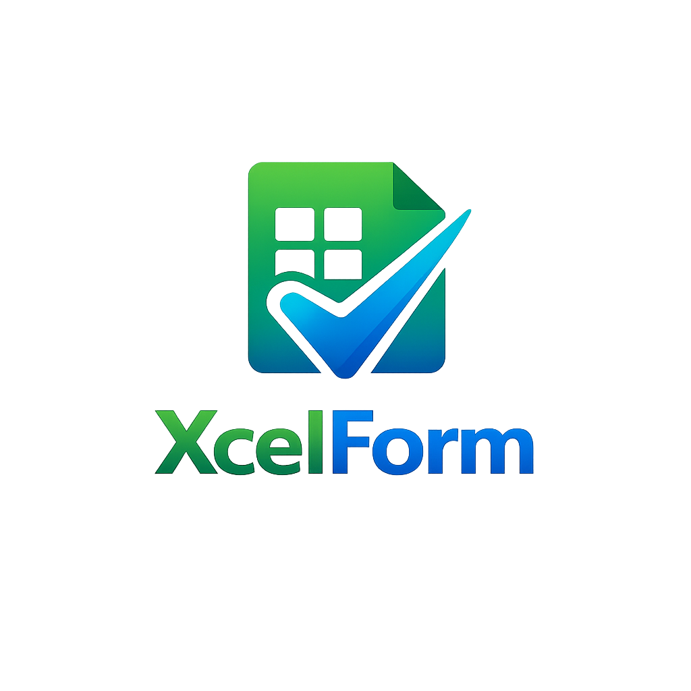

<p align="center">
  
</p>

<h1 align="center">📊 XcelForm</h1>

<p align="center">
<b>XcelForm</b> is a Frappe/ERPNext app that allows you to export data to Excel with custom formats and designs — just like print formats!
</p>

---

## 📢 **⚠️ Warning: Under Development!**
This app is currently **under development**.  
You are welcome to **test, explore, and contribute**! 🚀  

---

## 📚 **Features**
✅ Export any Doctype data into Excel with custom formats  
✅ Define multiple Excel templates for the same Doctype  
✅ Easy-to-use interface to create, manage, and apply Excel formats  
🧪 **Excel Preview feature** to test the format before export (**🔬 In Testing Stage**)  
✅ **Attach or Download Excel:** Option to attach Excel to the document or directly download it  
✅ **Report Export:** Export Script, Query and Custom Reports to Excel with your own format, using the filters applied on screen  
✅ **Excel Templates (no code):** Upload the client's own Excel file with `{{ placeholders }}` and XcelForm fills in the values  

---

## 🧩 **Excel Templates (no code)**
Design the file in Excel or LibreOffice exactly as the client wants it, type placeholders into the cells, and upload it.

1. Open **XF Excel Format** → **New**, pick the **Doctype**, keep **Format Type** = *Template*.
2. Click **Download Starter Template** to get an `.xlsx` with the doctype's fields and child tables already filled in, or use the client's own file.
3. Restyle it in Excel, then upload it in **Excel Template (.xlsx)** and save. XcelForm lists the placeholders it found and any cell that names a field that doesn't exist.
4. Export from the document's **XF Excel Export** button as usual.

| Write this in a cell | Result |
|---|---|
| `{{ doc.grand_total }}` | The real value. Numbers and dates stay numbers and dates, shown with the cell's own Excel number format |
| `Invoice {{ doc.name }} for {{ doc.customer }}` | Text mixed with values |
| `{{ items.qty }}` | The row repeats once per row of the `items` child table |
| `{{ items\|length }}`, `{{ doc.items[0].item_code }}` | The whole table or one row of it, in a normal cell |
| `{{ frappe.db.get_value("Customer", doc.customer, "tax_id") }}` | A value from another document, as in print formats |

When rows repeat, everything below moves down and formulas follow: `=SUM(D5:D5)` under a repeating row 5 becomes `=SUM(D5:D7)` for three items. Merged cells, row heights, conditional formatting, dropdowns, images and the print area move too. A table with no rows leaves one blank row.

For reports, use `{{ data.<fieldname> }}` for the repeating report rows, `{{ filters.company }}`, `{{ total_row.amount }}` and `{{ report_name }}`.

Optional extras on every format: a **File Name Pattern** such as `{{ doc.name }}-{{ doc.customer }}`, and a **Post-process Script** that runs after the template is filled (for example, to add a chart). Shapes, text boxes, SmartArt, pivot tables and macros are not kept; you get a warning on save if the file has them. Formats created before templates existed are set to *Script* automatically on `bench migrate`.

---

## ⚙️ **Installation**

```bash
# Get the app
bench get-app xcelform https://github.com/jezlan/xcelform.git

# Install on your site
bench --site your-site-name install-app xcelform

# Allow Excel format scripts to run (they run in Frappe's server-script sandbox)
bench set-config -g server_script_enabled 1
```

Template formats need nothing extra. Script formats (and post-process scripts) run in Frappe's sandbox, the same one Server Scripts use. Inside a script you can use `doc`, `wb`, `ws`, `frappe` (the safe version), and the openpyxl helpers `Font`, `Alignment`, `Border`, `Side`, `PatternFill`, `Image` and `get_column_letter`. Imports are limited to `from openpyxl... import Name`.

---

## 📝 **Usage**
1. Go to the respective Doctype.
2. Click on **XF Excel Format**.
3. Select the desired format.
4. Click **Preview** to test the format (currently in testing phase).
5. Choose whether to **attach** the file to the document or **download** it.
6. Export the customized Excel file!  

---

## ⚡️ **How It Works**
- **Excel Formats:** Define custom Excel formats in the **XF Excel Format** Doctype.
- **Excel Preview(🔬 Testing):** Allows users to preview the Excel layout and formatting before export.
- **Attach or Download:** Users can choose to attach the Excel file to the document or download it.  
- **Export Confirmation:** A success message appears when the file is attached or downloaded.  

---

## 🔧 **Configuring XF Settings for Excel Export**
To enable Excel export for a specific Doctype, follow these steps:  
1. Go to **XF Settings**.  
2. Add the desired Doctype in the **Doctypes Allowed for Export** section.  
3. Save the settings.  

✅ Now the selected Doctype can export Excel using **XcelForm**!  

---

## 📈 **Report Export**
Export Script Reports, Query Reports and Custom Reports with your own Excel layout.

1. Open **XF Report Excel Format** and click **New**.
2. Pick the **Report**, tick **Default for this Report** if you like, and edit the script. A working script is filled in for you.
3. Open the report, set the filters, then choose **XF Excel Export** from the report's menu (⋯).
4. Click **Preview** to check the layout, or **Download** to get the `.xlsx` file.

The menu item only appears on reports that have an enabled format, and only for users who can open the report.

A report script can use:

| Name | What it is |
|---|---|
| `report_name`, `filters` | The report and the filter values applied on screen |
| `columns` | List of dicts with `fieldname`, `label`, `fieldtype`, `options`, `width` |
| `data` | Rows as dicts keyed by fieldname (the total row is removed) |
| `total_row` | The report's total row as a dict, or `None` |
| `xf.write_table(ws, columns, data, start_row=1, start_col=1, total_row=None, header=True)` | Writes a styled table with number and date formats, returns the next empty row |
| `xf.autofit_columns(ws)` | Sizes columns to their content |

```python
ws["A1"] = report_name
ws["A1"].font = Font(bold=True, size=14)
xf.write_table(ws, columns, data, start_row=3, total_row=total_row)
xf.autofit_columns(ws)
```

Reports set to run in the background (prepared reports) export the last result generated with the same filters. Generate the report first, then export.

---


## 🤝 **Contributing**
Contributions are welcome!  
Feel free to open issues or submit pull requests to improve the app.  

---

## 📄 **License**
This project is licensed under the MIT License.  
See the [LICENSE](./license.txt) file for more details.  

---
